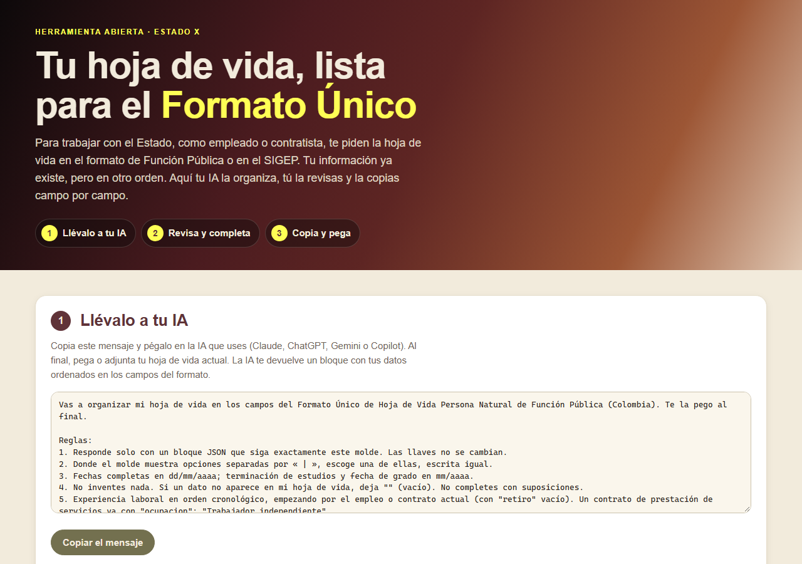

# Tu hoja de vida, lista para el Formato Único

**[Español](#español) · [English](#english)**

## Español

Herramienta abierta para **organizar tu hoja de vida en los campos del Formato Único de Hoja de Vida de Función Pública** y dejarla lista para copiar y pegar en el formato o en el SIGEP. Para quien se postula a un empleo público o a un contrato de prestación de servicios con el Estado.

**Ábrela aquí:** https://estado-x.github.io/hoja-de-vida-colombia/

### Qué hace

1. **Llévalo a tu IA.** Copias un mensaje con el molde de los campos, lo pegas en tu IA (Claude, ChatGPT, Gemini o Copilot) con tu hoja de vida actual, y la IA te devuelve tus datos ordenados. La IA tiene la orden de no inventar: lo que no encuentre queda vacío y te lo lista en «Me falta».
2. **Revisa y completa.** Pegas la respuesta en la página y se llena el formulario, con las secciones en el orden del formato. También se puede llenar a mano.
3. **Copia y pega.** Cada dato tiene su botón «Copiar» (y cada sección, «Copiar sección») para ir pegando en el SIGEP o en el formato oficial. Puedes imprimir o guardar en PDF una versión organizada.

Además calcula la **sección 7, tiempo total de experiencia**, por ocupación (servidor público, empleado del sector privado, trabajador independiente y docente), sin contar dos veces los periodos que se cruzan.

### Las secciones

Sigue la versión del formato de **marzo de 2026** (Función Pública):

| # | Sección |
|---|---|
| 1 | Datos personales |
| 2 | Formación académica: educación básica y media; educación superior |
| 3 | Educación para el trabajo y el desarrollo humano |
| 4 | Idiomas |
| 5 | Experiencia laboral |
| 6 | Experiencia laboral docente |
| 7 | Tiempo total de experiencia (se calcula) |
| 8 | Firma del servidor público o contratista |

La sección 9 (observaciones del jefe de recursos humanos o de contratos) la llena la entidad.

### Cómo funciona

- Es una página estática (HTML, CSS y JavaScript) publicada con GitHub Pages. No tiene servidor ni base de datos, no necesita claves y **no envía a ningún lado** lo que escribes.
- Solo guarda algo si marcas «Recordar en este navegador» (en el `localStorage` de tu navegador). También puedes descargar tus datos en un archivo `.json` y cargarlos después.
- `assets/esquema.js` tiene los campos del formato y lee el bloque que devuelve la IA; `assets/experiencia.js` calcula el tiempo total; `assets/app.js` es la interfaz. Las pruebas están en `pruebas/`.
- Tiempo total: une los periodos que se cruzan (Decreto 1083 de 2015, art. 2.2.2.3.8: el tiempo en el mismo periodo se cuenta una sola vez), cuenta meses calendario completos y suma los días sueltos de a 30. El empleo actual cuenta hasta hoy.

### Úsala o adáptala

1. Haz un fork de este repositorio.
2. Activa GitHub Pages (Settings → Pages → rama `main`, carpeta raíz).
3. Para probarla en tu computador: `python -m http.server` y abre `http://localhost:8000`. Para correr las pruebas: `node --test pruebas/` (Node 18 o superior, sin instalar nada).

Si Función Pública cambia el formato, ajusta `SECCIONES` en `assets/esquema.js`: el formulario, el mensaje para la IA, la lista para copiar y la impresión salen de ahí.

### Límites

- Es una ayuda para organizar, **no el formato oficial** ni un trámite ante Función Pública. La firma, la declaración de inhabilidades y los certificados los pones tú.
- La página de descargas de Función Pública todavía enlaza la versión anterior del formato (6 secciones). Los datos son los mismos, en otro orden.
- La IA puede equivocarse o inventar: revisa cada dato contra tus certificados. Lo que compartes con tu IA queda sujeto a las condiciones de esa IA.
- El tiempo total es una referencia. La entidad lo verifica con tus certificaciones; no aplica la regla de jornadas de menos de 8 horas.
- No incluye el Formato de Declaración de Bienes y Rentas ni la lista de municipios (se escriben a mano).

### Crédito

- Inspirada en [Reactive Resume](https://github.com/AmruthPillai/Reactive-Resume) de Amruth Pillai (licencia MIT). No reutiliza su código.
- Formato Único de Hoja de Vida Persona Natural: [Función Pública](https://www.funcionpublica.gov.co/documents/d/guest/formato_hoja_de_vida) (Leyes 190 de 1995, 489 y 443 de 1998; Decreto 1083 de 2015).

### Hecho por Estado X

[Estado X](https://estadox.com) · Licencia MIT.

---

## English

An open tool to **organize your résumé into the fields of Colombia's official public-sector CV form** (Formato Único de Hoja de Vida, issued by Función Pública), ready to copy and paste into the form or into SIGEP, the government's HR system. For anyone applying to a public job or a services contract with the Colombian State.

**Open it here:** https://estado-x.github.io/hoja-de-vida-colombia/

### What it does

1. **Take it to your AI.** Copy a message with the field template, paste it into your AI with your current résumé, and the AI returns your data in order. It is told not to make anything up.
2. **Review and complete.** Paste the answer back and the form fills itself, in the order of the official form. You can also type by hand.
3. **Copy and paste.** Every field has a «Copiar» button to paste into SIGEP or the official form. You can print or save an organized PDF.

It also computes section 7, **total work experience** by occupation, counting overlapping periods only once (Decree 1083 of 2015, art. 2.2.2.3.8).

### How it works

A static page on GitHub Pages: no server, no database, no keys, and **nothing you type leaves your browser**. It only stores data if you tick «Recordar en este navegador». Tests: `node --test pruebas/`.

### Limits

It helps you organize; it is **not the official form** and does not replace signing it. AI can make mistakes: check every field against your certificates. The experience total is a reference only.

### Credits

Inspired by [Reactive Resume](https://github.com/AmruthPillai/Reactive-Resume) by Amruth Pillai (MIT); no code reused. Official form: [Función Pública](https://www.funcionpublica.gov.co/documents/d/guest/formato_hoja_de_vida).

### Made by Estado X

[Estado X](https://estadox.com) · MIT License.
